# Frame

**A modern video player for Windows and Linux. Every feature is one key away.**

Frame opens your film and gets out of the way. The controls fade when you stop moving the mouse, and the keyboard reaches everything else: subtitles, chapters, speed, the playlist, screenshots. You never dig through a menu bar to find them.

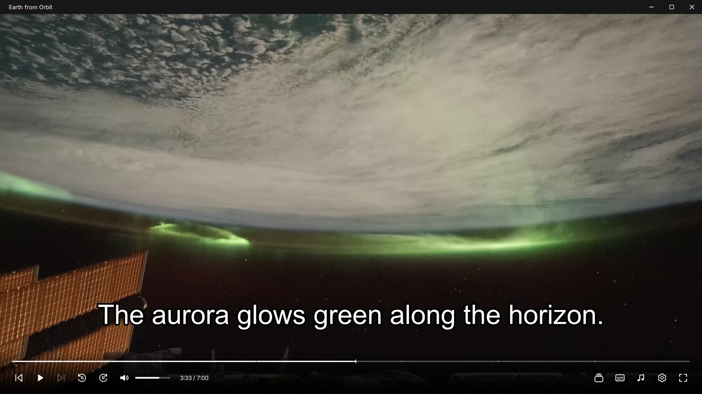

## Download

Open **[Releases](../../releases/latest)** and pick the file for your computer:

| Your computer | Download | How to install |
|---|---|---|
| Windows 10 or 11 (64-bit) | `Frame-Setup-0.8.0.exe` | Run it and follow the steps. |
| Windows, without installing | `Frame-0.8.0-win-x64.zip` | Unzip it anywhere and open `frame.exe`. |
| Ubuntu 26.04 (64-bit) | `frame_0.8.0_amd64.deb` | Open it in App Center, or run `sudo apt install ./frame_0.8.0_amd64.deb`. |

Setup on Windows has one box to tick if you want Frame to open your video files. Music files are a separate choice. You can also right-click any video and pick **Open with → Frame**.

## One key for each thing

Frame binds every action to a key. Most take a single press:

| Key | What it does |
|---|---|
| Space or K | Play or pause |
| Left / Right | Back or forward 5 seconds |
| Shift + Left / Right | Back or forward 30 seconds |
| , / . | One frame back or forward |
| J / L | Slower or faster; Backspace resets the speed |
| Up / Down | Volume |
| M | Mute |
| F | Fullscreen |
| T | Theater layout |
| P | Playlist |
| PgUp / PgDn | Previous or next video |
| C / V | Next subtitle track, subtitles on or off |
| A | Next audio track |
| Z / X | Move subtitles earlier or later |
| B / Shift + B | Set the start and end of a loop |
| S | Save a screenshot; Ctrl + S copies the frame instead |
| O | Open a video |
| Ctrl + H | Chapters |
| Ctrl + I | What you're playing: codecs, size, frame rate |
| Ctrl + , | Settings |
| F1 | The shortcut guide |

You can change any of them in Settings, and put them all back with one button. Your media keys work too.

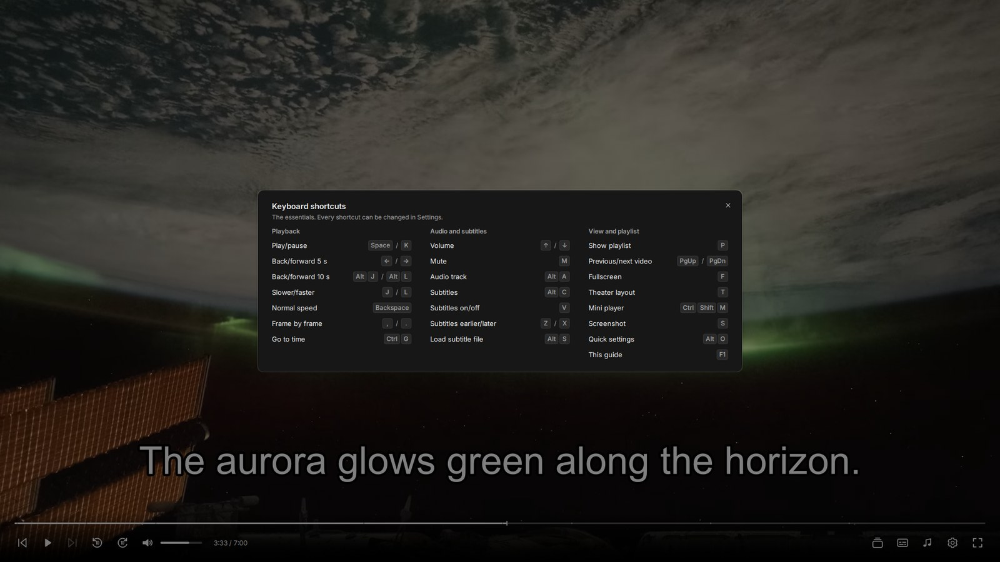

## A quick tour

### The picture comes first

Move the mouse and the controls come back. Leave it still and they fade, leaving only the film.

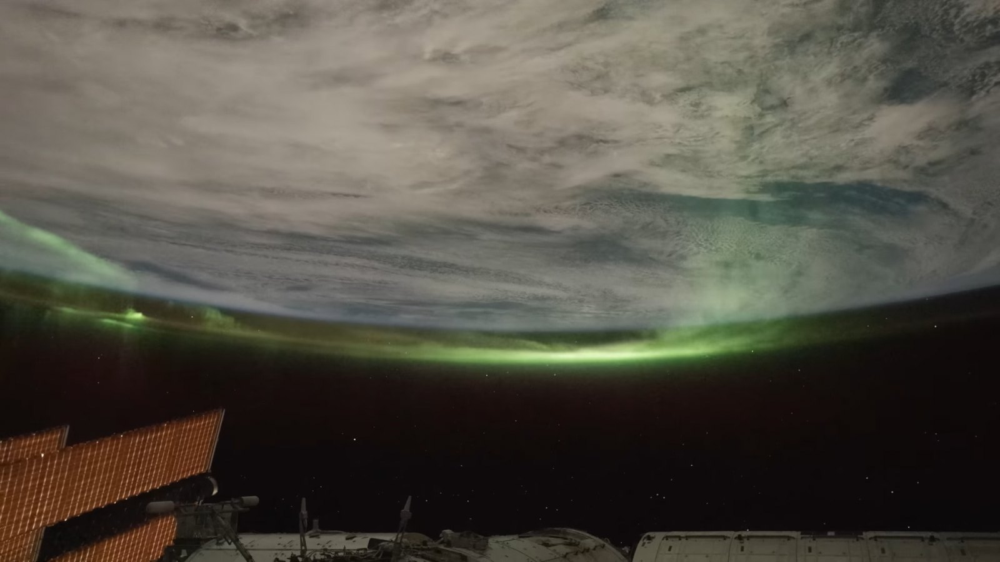

### Subtitles

Frame finds subtitles inside the video, or a subtitle file with the same name sitting next to it. Press **Alt + C** for the track list, which also lets you load another file. Pick a language once and Frame uses it for the next videos too.

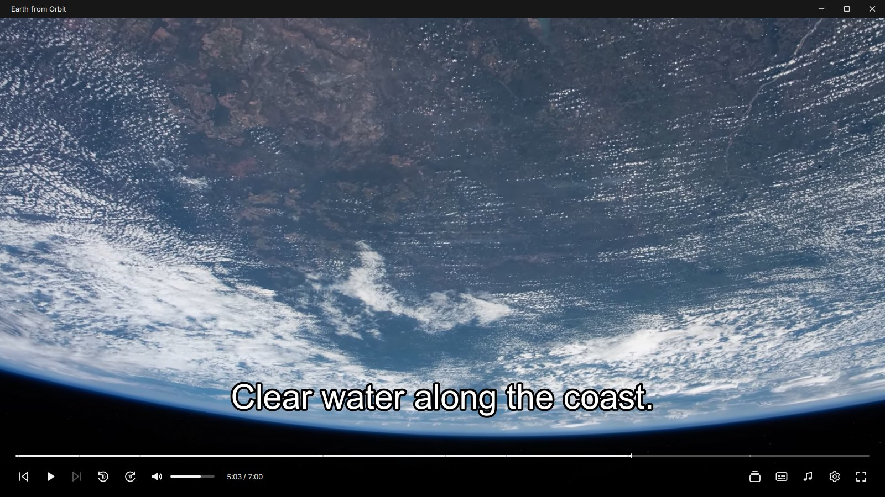

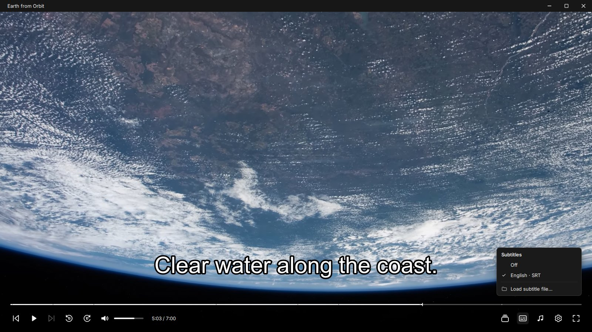

### Chapters

Chapters show as small marks on the progress bar. **Ctrl + H** lists them by name so you can jump to one.

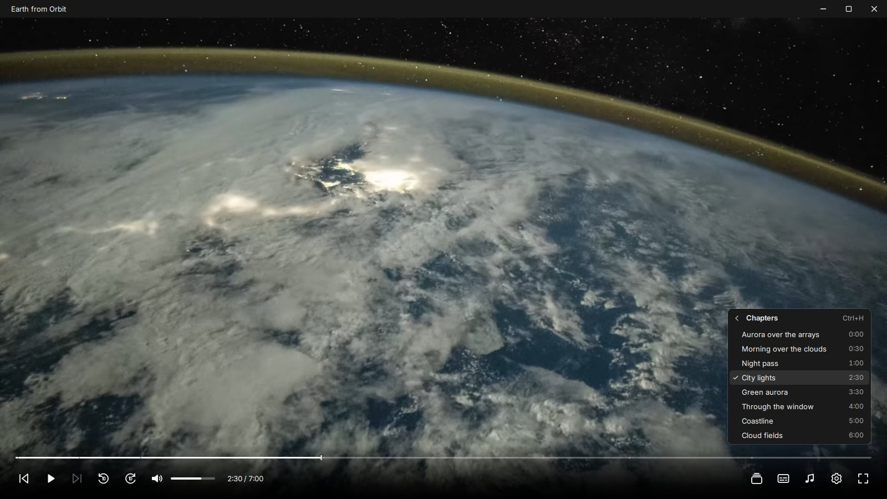

### Playlist with previews

Open one video and Frame queues up the rest of the folder. Press **P** to see what's next. Drag to reorder, search a long list, or drop more files on the window.

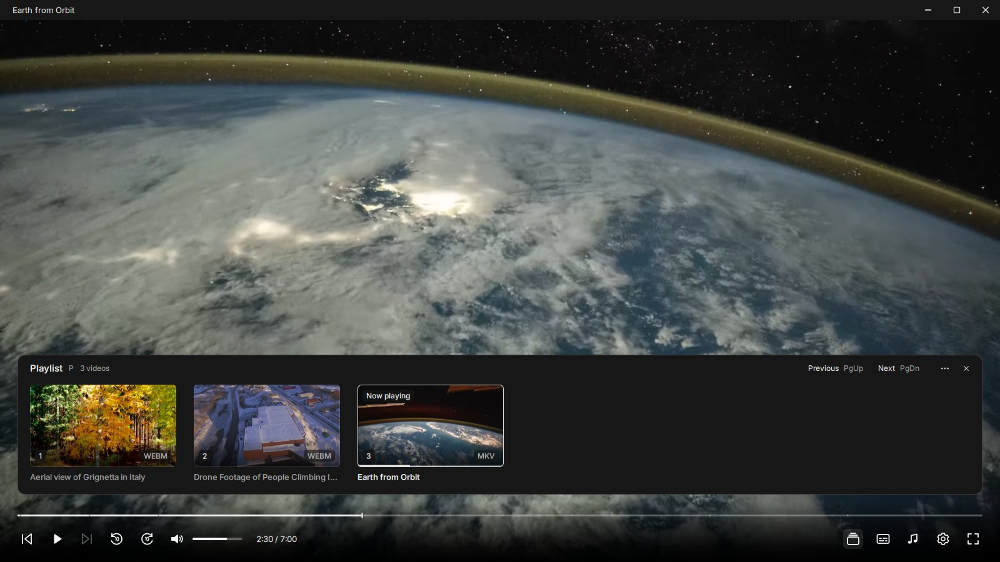

### Theater layout

**T** moves the playlist beside the picture.

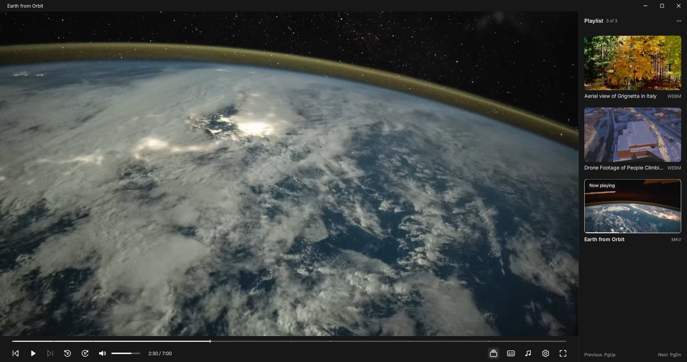

### Quick settings

**Alt + O**, or the gear, gives you speed, picture shape, looping and always-on-top in one small panel.

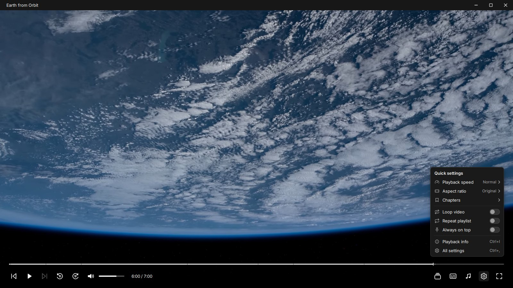

### Right-click

Right-click the picture for the full menu. **Recent Files** brings back what you watched last.

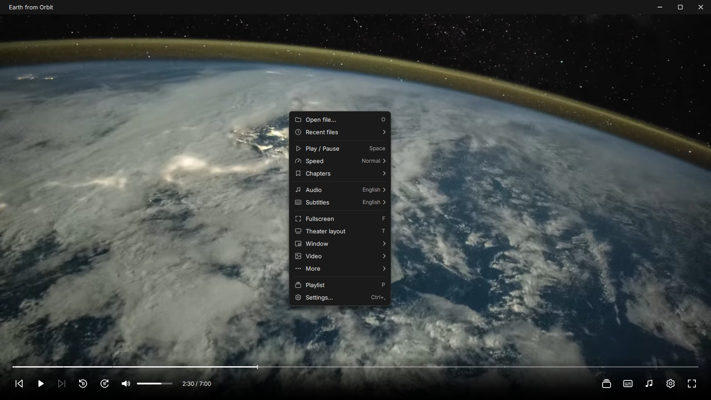

### Settings

**Ctrl + ,** opens Settings. Changes save as you make them, and each setting has its own reset button. You can make subtitles bigger, recolor them, thicken the outline or move them up the screen.

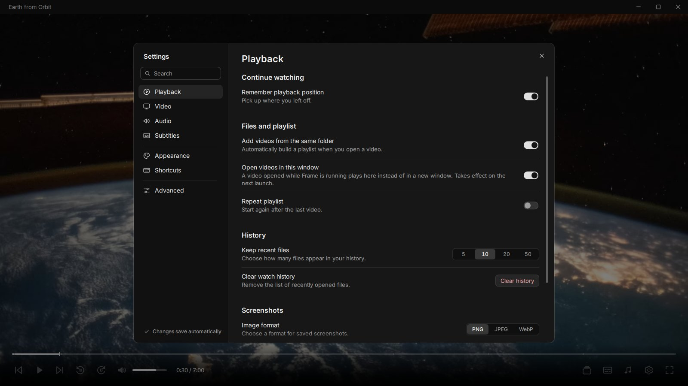

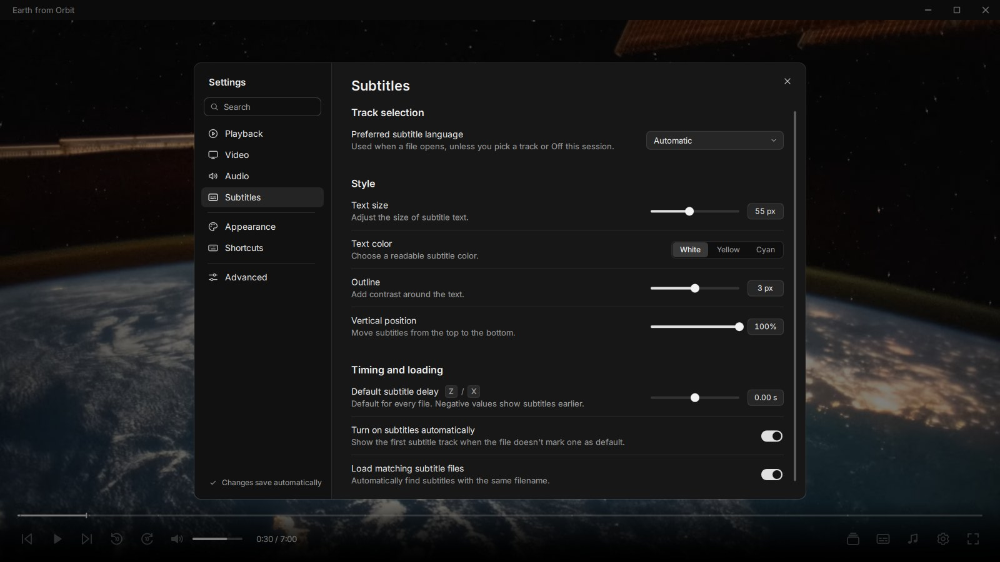

The Shortcuts page lists every action, and you can rebind any of them there.

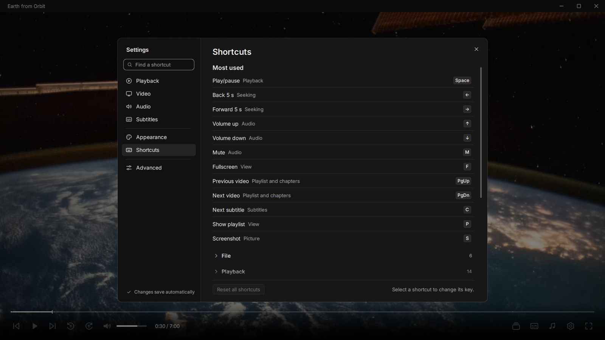

### Know your file

**Ctrl + I** shows the video and audio format, picture size, frame rate, and whether your graphics card is decoding.

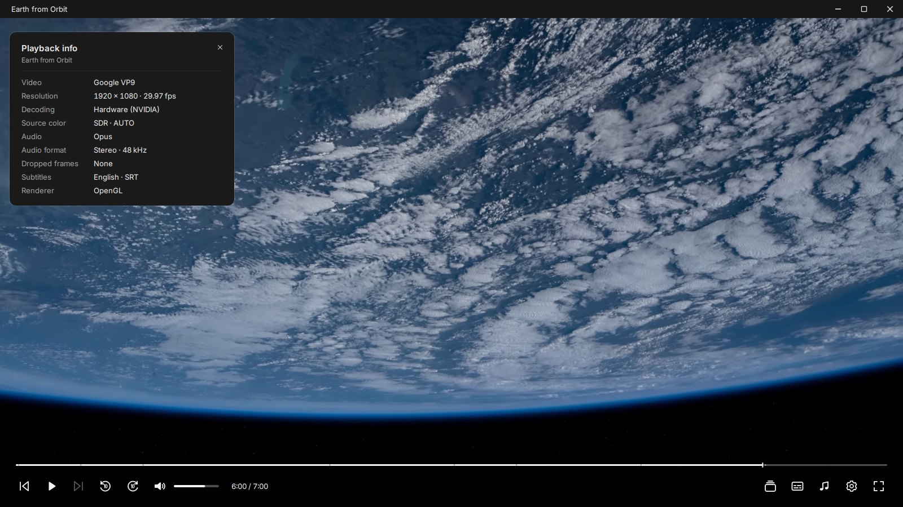

### Music

Frame plays music files too. You get the cover, title, artist and album over a waveform of the whole track.

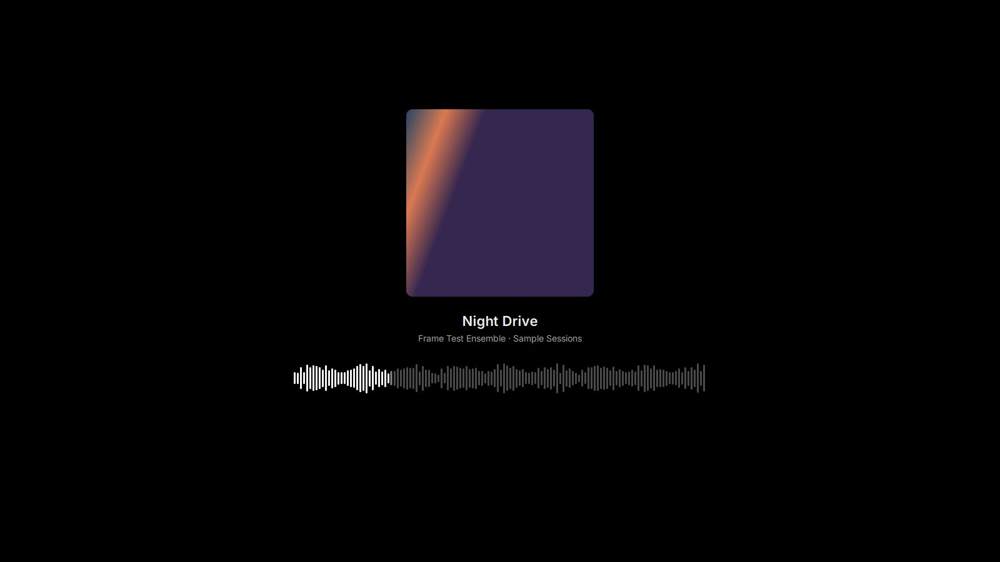

### File icons on Windows

Files that open in Frame get their own icons, with the format printed on a colored label you can read even in the smallest list view.

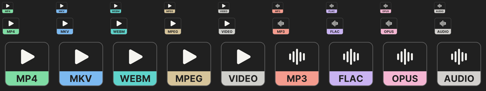

## Small things Frame handles for you

- Close a film halfway and it reopens at the same spot. Frame saves your place as you watch, so a crash won't lose it.
- When a video ends, the next one in the playlist starts.
- Opening another video while Frame is running plays it in the same window. Settings can turn that off.
- Your screen stays awake while a video plays.
- Paste a video's web address and Frame streams it.
- The window comes back at the size and position you left it.

## Updates

Right-click the picture, choose **More → About Frame**, then **Check for updates**. Frame checks only when you ask.

## Help

Open an issue from the **Issues** tab. Include your Windows or Linux version, what you were doing, and any message you saw. Leave out copyrighted videos and private stream links. The [user guide](docs/USER-GUIDE.md) covers every feature in more detail.

## License

Frame has two licenses.

**Free under the [GNU GPL v3](LICENSE).** Watch videos with it at home or at work, use it in personal, school and non-profit projects, and build it into free and open-source software that publishes its source under the GPL.

**Paid commercial license.** If you want to put Frame's code into a product you sell or ship without publishing your source, you need a commercial license. [COMMERCIAL-LICENSE.md](COMMERCIAL-LICENSE.md) explains how to ask for one.

Frame runs on [Qt](https://www.qt.io/) and [mpv](https://mpv.io/), which keep their own licenses. See [NOTICE](NOTICE) and [Licensing](docs/LICENSING.md).

## About the screenshots

The film, shown as *Earth from Orbit*, is *Earth in 4K: Space Station Expedition 67-68 Edition* by NASA Johnson Space Center, in the public domain. The chapter names and captions were added for these pictures. The other playlist clips, *Aerial view of Grignetta in Italy* and *Drone Footage of People Climbing Ice Formation*, come from Wikimedia Commons under CC0. The music track is a test recording made for Frame.

## Building from source

[Building Frame](docs/BUILDING.md) covers the build. Read [Contributing](CONTRIBUTING.md) before sending a change.

Copyright (C) 2026 VahamCooKey.
